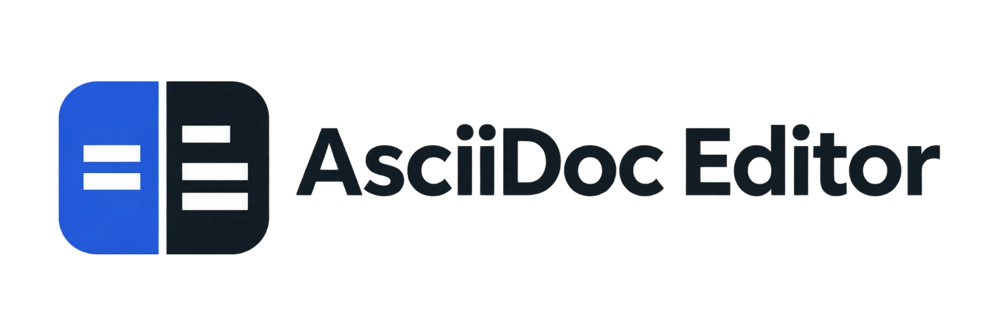
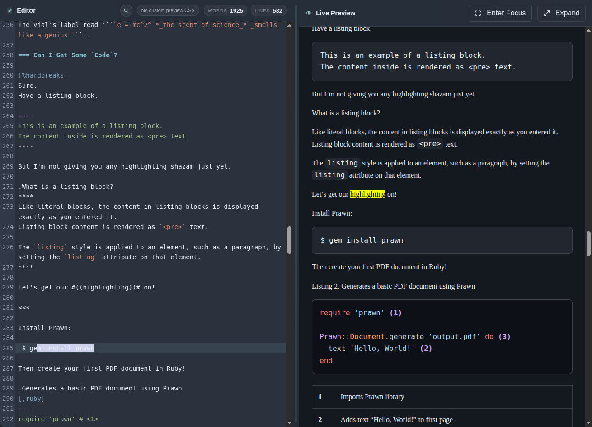
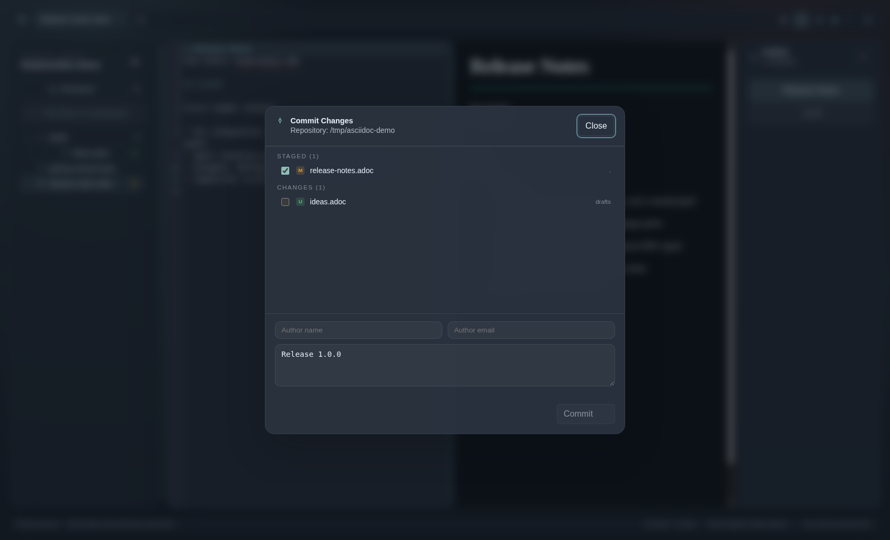
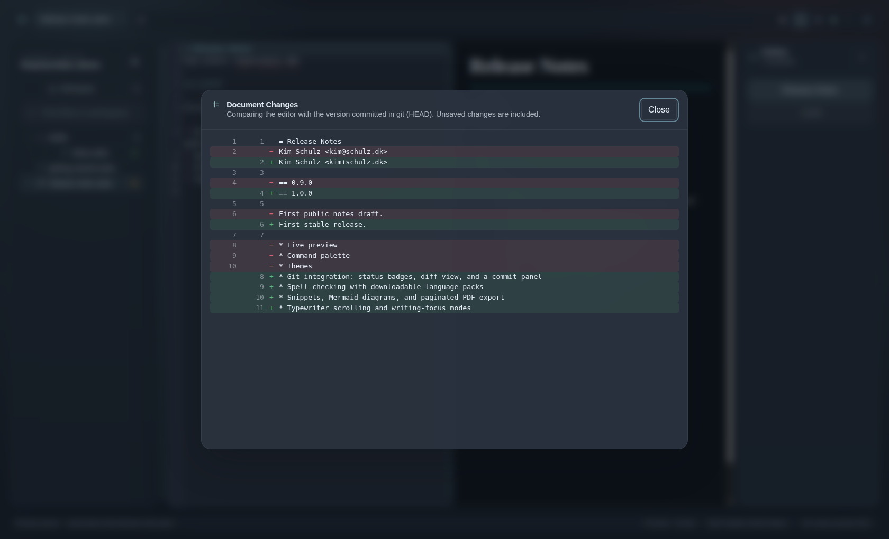
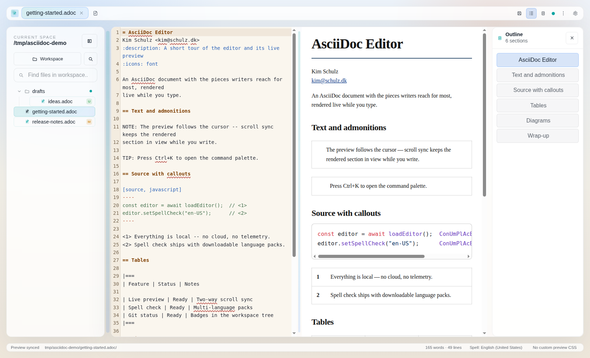

# AsciiDoc Editor

<p align="center">
  
</p>

<p align="center">
  
</p>

AsciiDoc Editor is a standalone desktop app for writing and editing AsciiDoc with a live preview, integrated workspace tools, and export options.

It is built with Electron and Vite, and uses `asciidoctor.js` for standards-based AsciiDoc rendering.

## Screenshots

The editor in the default dark theme, with the workspace tree showing live git status badges:

<p align="center">
  
</p>

Built-in git integration — stage and commit changes without leaving the editor:

<p align="center">
  
</p>

Compare the open document against the version committed in git:

<p align="center">
  
</p>

Light themes are included too — here is the same document in Porcelain:

<p align="center">
  
</p>

## Highlights

- Live source + preview editing with resizable split view and two-way scroll sync
- Built-in git integration: status badges in the workspace tree, a diff view against HEAD, and a stage-and-commit panel
- AsciiDoc autocomplete: block templates, source languages, document attributes, and macros
- Snippet expansion in the editor for frequently used markup
- Spell checking with downloadable language packs
- Typewriter scrolling and paragraph focus dimming for distraction-free writing
- Mermaid diagram rendering in the preview
- Paginated PDF export via Paged.js, alongside HTML and DocBook 5
- Command palette (Ctrl+K / Ctrl+Shift+P) for actions, open tabs, the outline, and workspace files
- Compact interface with a slim toolbar, status bar, and optional classic menu bar (Alt)
- Built-in themes for the app and editor; the preview can be kept light or dark independently of the app theme
- AsciiDoc rendering via `asciidoctor.js` (includes, attributes, xrefs, tables, footnotes, conditionals, and more)
- Syntax-highlighted editor with AsciiDoc-aware coloring
- In-document find and replace with match navigation
- Workspace browser with recursive filtering and drag-to-insert assets
- Workspace-wide search and replace across project files
- Built-in searchable markup reference with snippet insertion
- Portable `.adp` project files with project/session restore
- Automatic update checks, with in-app self-updates on supported platforms
- Packaging: Linux AppImage, `.deb`, `.rpm`, and `.pacman`; Windows installer, portable `.exe`, and `.zip`

## Project Structure

- `electron/`: Electron main process, preload bridge, rendering/export helpers, app state
- `src/`: Renderer UI (Vite), editor integration, syntax support, styles
- `tests/`: Unit tests for rendering and services, plus Playwright end-to-end tests driving the packaged layout
- `tools/`: Windows/Linux helpers for `.adp` file association

## Development

Install dependencies:

```bash
npm install
```

Run tests:

```bash
npm test
```

Run the app in development:

```bash
npm start
```

Build renderer assets:

```bash
npm run build
```

Package Linux builds (AppImage, `.deb`, `.rpm`, `.pacman`):

```bash
npm run package:linux
```

Package Windows builds (installer, portable `.exe`, `.zip`):

```bash
npm run package:win
```

## Releases

GitHub Actions workflow: `.github/workflows/release.yml`

Build targets:

- Linux AppImage, `.deb`, `.rpm`, `.pacman` (`ubuntu-latest`)
- Windows installer, portable `.exe`, and `.zip` (`windows-latest`)

Typical release flow:

1. Create and push a version tag (for example `v0.5.0`)
2. Let GitHub Actions build artifacts
3. Download release assets from the tagged GitHub release

The workflow also supports manual runs via `workflow_dispatch`.

## Validation Status

Tests and the renderer build run in CI on every push and pull request (`.github/workflows/ci.yml`), and again before packaging on release tags.

## File Association Helpers

Tagged releases include optional `.adp` association helpers:

- `tools/windows/register-adp-file-association.reg`: user-level Windows registry template
- `tools/linux/register-adp-file-association.sh`: user-local MIME/desktop registration for an AppImage path

## Important Notes

- AsciiDoc language support depends on `asciidoctor.js` capabilities.
- PDF export is Chromium print-based and is not equivalent to `asciidoctor-pdf`.
- Windows packaging from Linux requires `wine` (or a Windows runner).
- Linux AppImage can require FUSE 2 runtime support (for Ubuntu 24.04 this is typically `libfuse2t64`).
- `.adp` file-association scripts are path-based and must be rerun if the app path changes.

## License and Credits

Developed and maintained by Kim Schulz.

Licensed under MIT. Contributions are welcome.
